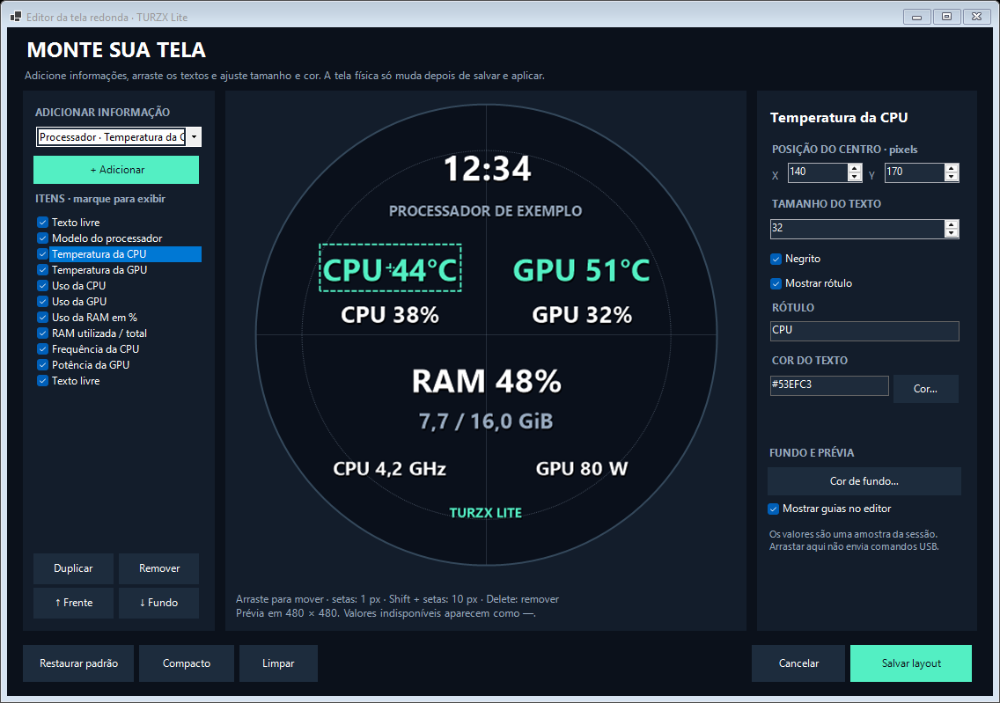

# TURZX Lite

[English](README.md) | **Português (Brasil)**

Controlador independente para um display redondo TURZX USB de 480 × 480 pixels.
Reúne painel de sensores, imagens, vídeo H.264 nativo e editor visual de layout.
Aplicação Windows x64, interface em português e inglês e atualização de sensores a 1 Hz.

## Compatibilidade

| Item | Suporte desta versão |
| --- | --- |
| Display testado | TURZX USB redondo, 480 × 480 |
| Identificação USB | VID `1CBE`, PID `0028` |
| Transporte | WinUSB, com o driver do display já instalado |
| Sistema | Windows x64 compatível com .NET 10 |
| GPU direta | NVIDIA, por NVML do driver instalado |

O suporte foi validado para essa identificação USB específica.
Displays vendidos com nomes ou tamanhos semelhantes podem usar protocolos diferentes.
Este projeto não oferece compatibilidade universal com produtos TURZX nem representa o fabricante.

Tenha o display reconhecido pelo Windows com o driver WinUSB usado pelo software original.
O TURZX Lite não substitui o driver USB do display.
Feche o programa original, inclusive seu ícone na bandeja, antes de conectar pelo TURZX Lite.

## Executar

Se você já possui a pasta portátil publicada, abra `TURZX Lite.exe`.
A publicação inclui o runtime: não é necessário instalar o .NET para executá-la.
Mantenha juntos os arquivos distribuídos na pasta.

1. Abra o aplicativo e selecione a tela; use **Buscar** se necessário.
2. Escolha **Painel**, **Imagem** ou **Vídeo** nos botões de conteúdo.
3. Para mídia, escolha o arquivo e ajuste brilho, rotação e sobreposição.
4. Clique em **Conectar / aplicar**.

**Testar prévia** funciona sem enviar comandos ao display USB.
**Parar** encerra o envio; a última imagem pode permanecer na tela.
Minimize para manter o aplicativo na bandeja e dê dois cliques no ícone para restaurar a janela.
Fechar a janela ou escolher **Sair** encerra o aplicativo.

**Iniciar com o Windows**, **Conectar automaticamente ao abrir** e **Abrir minimizado na bandeja** são opcionais.
Marque as opções desejadas e use **Conectar / aplicar** para salvá-las.
Se habilitar a inicialização com o Windows, mantenha a pasta portátil no mesmo local.

## Idiomas

A interface oferece **Português (Brasil)** e **English**.
Use **Idioma / Language**, no topo da janela, para trocar e salvar a preferência.
A troca atualiza a interface sem reiniciar a sessão USB ou a reprodução.
Os nomes de botões deste guia usam a interface em português.

## Modos de conteúdo

| Modo | Comportamento |
| --- | --- |
| **Painel** | Informações configuráveis, atualizadas a 1 quadro por segundo. |
| **Imagem** | Imagem estática; sem sobreposição, é enviada uma vez por aplicação. |
| **Vídeo** | Reprodução em repetição por H.264 decodificado no próprio display. |

Imagens e vídeos podem receber informações por cima quando **Sobrepor métricas** está marcado.
As métricas continuam atualizando a 1 Hz, independentemente da taxa do vídeo.
Use a rotação de 0°, 90°, 180° ou 270° conforme a montagem física do display.

## Vídeo a 24, 30 ou 60 fps

Selecione **Vídeo**, escolha um arquivo e configure a taxa desejada.
A primeira reprodução prepara uma versão H.264 de 480 × 480 e a armazena em cache.
O arquivo preparado é reutilizado nas próximas reproduções com a mesma configuração.
Alterar a mídia, a rotação ou a taxa de quadros pode exigir nova preparação.

Após a preparação, o display recebe os blocos comprimidos e executa a decodificação.
Isso evita recompor e enviar todos os quadros completos continuamente no PC.
A conversão inicial ainda utiliza CPU, e a fluidez depende também da mídia e da conexão USB.
O vídeo é reproduzido sem áudio.

**A prévia na janela usa cerca de 2 fps; esse valor não limita os fps do display.**
Ela usa um decodificador separado e é pausada quando a janela está minimizada.
O painel de sensores e a sobreposição têm cadência própria de 1 Hz.

O aplicativo precisa de um `ffmpeg.exe` externo para preparar vídeos e gerar a prévia.
Selecione seu caminho no campo **FFMPEG · DECODIFICADOR DE VÍDEO**.
Você pode apontar para uma cópia que já possui, inclusive a fornecida com o programa original.
Não é necessário executar o programa original para usar esse arquivo.
FFmpeg não é redistribuído neste repositório ou incorporado ao executável.
Clipes preparados acima de 512 MB são recusados; prefira vídeos mais curtos.

## Editor visual

Abra **Editar layout / escolher informações** para montar a tela redonda.
O catálogo contém **25 tipos de informação**, incluindo texto livre, relógio e dados de CPU, GPU e RAM.
Cada layout aceita até **40 itens**, inclusive itens ocultos.

- Escolha uma informação no catálogo e clique em **+ Adicionar**.
- Clique em um texto na tela redonda e arraste para reposicioná-lo.
- Ajuste X e Y para posicionamento preciso; as coordenadas representam o centro do texto.
- Configure tamanho da fonte, negrito, rótulo e cor de cada item.
- Marque ou desmarque itens na lista para exibir ou ocultar.
- Use **Duplicar**, **Remover**, **Frente** e **Fundo** para organizar as camadas.
- Com a tela do editor focada, as setas movem 1 pixel; Shift + setas movem 10 pixels.
- Delete remove o item selecionado.

O editor também oferece cor de fundo, guias, **Restaurar padrão**, **Compacto** e **Limpar**.
**Salvar layout** persiste as alterações e atualiza a sessão ativa, sem reiniciar a reprodução.
**Cancelar** descarta as alterações feitas no editor.
O fundo de imagem ou vídeo continua sendo escolhido na janela principal.



## Sensores

Uso de CPU, memória utilizada/disponível/total, relógio e tempo ligado são obtidos pelo Windows.
Sensores ausentes aparecem como **—**; a disponibilidade varia por hardware e driver.
O catálogo permite escolher uma informação mesmo quando seu valor está indisponível.

### Temperatura direta da CPU

Clique em **Ativar temperatura da CPU** para iniciar o auxiliar integrado de sensores.
Somente esse auxiliar solicita elevação pelo UAC; a interface principal continua sem elevação.
A leitura usa LibreHardwareMonitorLib 0.9.6 e o driver oficial PawnIO.
O leitor direto habilita a categoria CPU e consulta seus sensores a 1 Hz.
Temperatura, frequência e potência são exibidas quando disponibilizadas pela CPU e pelo driver.

Se necessário, o auxiliar baixa e instala o **PawnIO 2.2.0** da publicação oficial.
O instalador tem seu SHA-256 fixado no código e é conferido antes da execução.
O driver oficial é assinado; o aplicativo não desativa a verificação de assinatura do Windows.
Essa instalação é uma alteração no sistema e pode permanecer após fechar a aplicação portátil.
A preferência de leitura direta é lembrada; o Windows pode solicitar UAC em uma nova execução.
Cancelar o UAC mantém o restante do aplicativo disponível.

Veja a [publicação oficial do PawnIO 2.2.0](https://github.com/namazso/PawnIO.Setup/releases/tag/2.2.0)
e os detalhes em [THIRD-PARTY-NOTICES.md](THIRD-PARTY-NOTICES.md).

### GPU e monitores opcionais

GPU NVIDIA usa a biblioteca NVML da instalação do driver para temperatura, utilização e outros dados disponíveis.
O aplicativo não redistribui o driver NVIDIA.
HWiNFO e AIDA64 **não são exigidos** para a leitura direta integrada.
Como alternativas, podem fornecer valores por memória compartilhada quando já estiverem abertos e configurados.
No HWiNFO, habilite **Shared Memory Support**; no AIDA64, habilite a publicação para aplicações externas.
Essas integrações respeitam a disponibilidade e as limitações dos programas externos.

## Configurações e arquivos locais

Os dados do aplicativo ficam em `%LOCALAPPDATA%\TurzxLite`:

| Arquivo/pasta | Conteúdo |
| --- | --- |
| `settings.json` | Preferências e layout, incluindo posições, cores e visibilidade. |
| `app.log` e `app.log.old` | Registros de execução e falhas. |
| `VideoCache` | Vídeos H.264 preparados para reutilização. |

Cole esse caminho no Explorador de Arquivos para abrir a pasta.
Ao relatar um problema, revise os logs antes de publicá-los: eles podem conter caminhos locais de mídia.

## Compilar

Requisitos de desenvolvimento: Windows x64, PowerShell e **SDK .NET 10**.
Na raiz do repositório:

```powershell
.\build.ps1
```

Abra o executável publicado:

```powershell
& ".\dist\TURZX Lite\TURZX Lite.exe"
```

O script restaura as dependências e publica a aplicação autossuficiente em `dist\TURZX Lite`.
Para compilar e abrir em seguida, use `.\build.ps1 -Run`.

## Limitações e componentes

Não há garantia de eliminar todo travamento: firmware, conexão USB, drivers e mídia também influenciam o resultado.
O programa controla o conteúdo do display; não é uma ferramenta de controle da bomba ou das ventoinhas do water cooler.
Consulte [THIRD-PARTY-NOTICES.md](THIRD-PARTY-NOTICES.md) para componentes, versões, fontes e condições de terceiros.
Os nomes e marcas citados pertencem a seus respectivos titulares.
