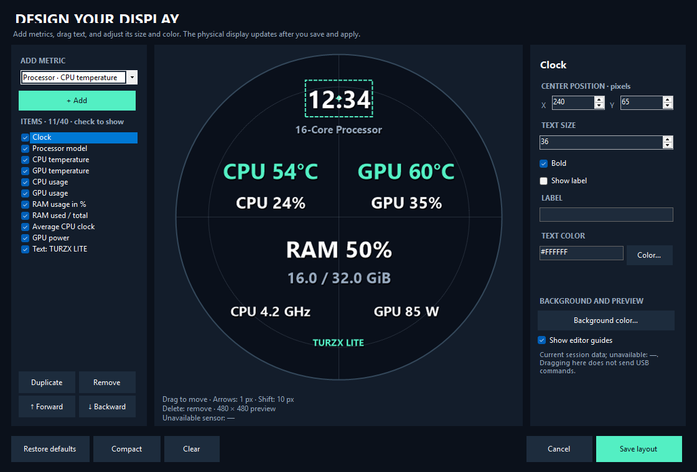

# TURZX Lite

**English** | [Português (Brasil)](README-PTBR.md)

An independent Windows controller for a round **480 × 480 TURZX USB display**.
Build a sensor dashboard, show your own images/videos, and position each metric with a visual layout editor.
The interface supports **English and Brazilian Portuguese**.



## Compatibility

| Component | Supported configuration |
| --- | --- |
| Display | Round 480 × 480 TURZX, USB VID `1CBE`, PID `0028` |
| Connection | WinUSB, using the display's existing Windows driver |
| Operating system | Windows x64 supported by .NET 10 |
| Direct GPU readings | NVIDIA through the installed driver's NVML library |

Other TURZX screens can use different protocols even when their appearance is similar. Compatibility is limited to the tested USB family.
This independent project is not affiliated with or endorsed by the hardware manufacturer.

## Features

- Sensor dashboard, clock, date and custom text.
- Your own images with optional metric overlays.
- Looping **24, 30 or 60 FPS H.264 video**, decoded by the display.
- Drag items, set coordinates, and change font size, color, labels, visibility and stacking order.
- **25 metric/text types**, with up to **40 layout items**.
- Integrated CPU temperature, average clock and package power without keeping HWiNFO or AIDA64 open.
- English/Portuguese selection, brightness, rotation, system tray and optional Windows startup.

## Build and run

Build requirements: **Windows x64**, **.NET 10 SDK**, and NuGet access to restore dependencies.

```powershell
git clone https://github.com/jeankassio/TURZX-Lite.git
cd TURZX-Lite
.\build.ps1
& '.\dist\TURZX Lite\TURZX Lite.exe'
```

The build produces a self-contained application in `dist/TURZX Lite/`; users of this published build do not need to install .NET.
Keep the accompanying documentation and third-party notices with the executable.
This repository contains source code; executables, vendor software and personal media are not committed.

### First connection

1. Make sure Windows recognizes the display with its existing WinUSB driver.
2. Close the original TURZX application, including its tray icon.
3. Open TURZX Lite, select the display and use **Scan** if needed.
4. Choose **Dashboard**, **Image** or **Video**, adjust the options, then click **Connect / apply** or **Play video**.

**Preview** does not send USB commands. Minimizing keeps playback running in the tray; double-click the icon to restore the window.
Closing the window or selecting **Exit** ends the application. Startup, automatic connection and starting minimized are optional.

## Language

Select **English** or **Português (Brasil)** from **Language / Idioma** at the top of the main window.
The preference is saved locally and can change without reconnecting USB or restarting video.
File paths, custom text, metric IDs and layout coordinates are preserved.

## Layout editor

Click **Edit layout / choose metrics**:

1. Choose a metric on the left and click **+ Add**.
2. Drag its text in the circular preview or adjust its center using **X/Y**.
3. Set size, bold, color and label. Use **Custom text** for your own captions.
4. Uncheck items to hide them, duplicate/remove them, or change their stacking order.
5. Click **Save layout** to save and apply it to the active session.

Arrow keys move one pixel; **Shift + arrow** moves ten; **Delete** removes an item.
Default/compact presets are included. **Cancel** leaves the layout unchanged and guides appear only in the editor.
The same layout is used for the dashboard and image/video overlays. Saving does not reconnect USB or restart native video.

| Category | Available information |
| --- | --- |
| CPU | Model, utilization, temperature, average clock, package power, logical processors |
| GPU | Model, utilization, temperature, VRAM used/total/percentage, GPU/memory clocks, power, fan percentage |
| RAM | Used, available, total, utilization percentage, used/total |
| System | Clock, date, uptime |
| Custom | Your own text |

Unavailable readings show **—**. Sensors are polled at **1 Hz**, independently of video FPS or the number of layout items.

## Video and FFmpeg

An external **FFmpeg** executable is required for preparation and the window preview. It is not redistributed here.
Select `ffmpeg.exe` in the app if discovery does not find it. A compatible executable from an existing installation, including the original TURZX installation, can be used without launching the original program.
Discovery checks the application directory, its `FFmpeg` subdirectory, an existing vendor directory under Documents, and `PATH`.

Choose **Video → Choose video…**, select your file and **24, 30 or 60 FPS**, then click **Play video**.
First playback prepares a cached 480 × 480 H.264 copy using one low-priority FFmpeg thread; later playback reuses it.
The display decodes video while overlays update separately at 1 Hz. The window preview runs at **2 FPS** and stops decoding when minimized.
Layout changes do not require another conversion. Converting a slower source to 60 FPS repeats frames; it does not create new motion.

Prepared files are limited to **512 MiB each**; cache cleanup keeps retained files to roughly **1 GiB** including a new prepared file.
Large/high-resolution sources can require substantial work during their first conversion.

## Integrated CPU sensors

Click **Enable CPU temperature** and approve the Windows administrator prompt.
The app starts a sensor-only helper from the same executable; the main window and USB remain unelevated.
First activation downloads and installs the official **PawnIO 2.2.0** driver after checking its pinned SHA-256 hash.
Later sessions use that driver. Windows can ask for administrator approval again for each new helper session.
The helper exits with the app; the installed driver remains available.

**LibreHardwareMonitorLib 0.9.6** monitors only CPU hardware, once per second. Motherboard, storage, controller and SMBus polling are disabled.
HWiNFO/AIDA64 are not required; their shared-memory readings remain optional alternatives.
NVIDIA readings use the installed driver's NVML library.
Driver details, hashes and dependency licenses are in [THIRD-PARTY-NOTICES.md](THIRD-PARTY-NOTICES.md).
The app does not expose firmware updates or cooling pump/fan control.

## Settings and troubleshooting

Local data is under `%LOCALAPPDATA%\TurzxLite`:

| Location | Purpose |
| --- | --- |
| `settings.json` | Language, media, display options and layout |
| `app.log` / `app.log.old` | Bounded diagnostic logs |
| `VideoCache/` | Prepared H.264 files |

- **Display missing:** check USB, its driver and use **Scan**.
- **USB error:** close the original software, stop playback, check the cable and reconnect in the app.
- **Video does not open:** check media/FFmpeg paths; try a shorter clip or dashboard preview.
- **CPU unavailable:** use **Enable CPU temperature** or **Restart CPU sensor** and allow the Windows prompt.
- **Rotated image:** choose 0°, 90°, 180° or 270° and apply.
- **Slow preview:** the window preview is intentionally 2 FPS; the physical display uses the selected native rate.

Performance depends on the display, USB connection, drivers and media; behavior is not guaranteed across all hardware or source files.

## Developer checks

```powershell
dotnet build .\src\TurzxLite\TurzxLite.csproj -c Release
dotnet '.\src\TurzxLite\bin\Release\net10.0-windows\TURZX Lite.dll' --self-test --output .\artifacts\self-test
```

The offline self-test checks packet construction, rendering, cancellation and UI construction without sending USB commands.
Code separates telemetry, layout rendering/editing, USB transport, video preparation and the optional elevated CPU helper.

## Third-party components

See [THIRD-PARTY-NOTICES.md](THIRD-PARTY-NOTICES.md) for original licenses and source references.
FFmpeg, vendor software, HWiNFO, AIDA64 and the NVIDIA driver remain external installations.
